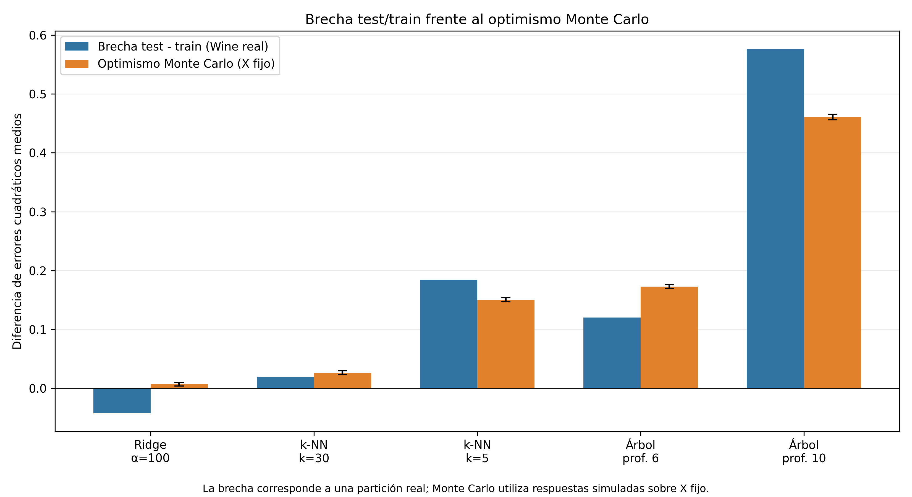

# 3.5. Brecha entre prueba y entrenamiento frente al optimismo

## Objetivo
Comparar la brecha observada en la partición real de Wine Quality Red con el optimismo estimado en las 50 simulaciones Monte Carlo del inciso 3.4, distinguiendo los escenarios estadísticos que representa cada cantidad.

## Definiciones

La brecha en datos reales se calcula como

$$
\Delta_{\mathrm{test/train}}=\operatorname{MSE}_{\mathrm{test}}-\operatorname{MSE}_{\mathrm{train}}.
$$

El optimismo empírico Monte Carlo se estima promediando las diferencias de error sobre nuevas respuestas independientes, generadas en **los mismos puntos** $X_{\mathrm{train}}$:

$$
\widehat{\mathrm{Opt}}_{\mathrm{MC}}=\frac{1}{50}\sum_{b=1}^{50}\left[\operatorname{MSE}(y_{\mathrm{new}}^{(b)},\hat y^{(b)})-\operatorname{MSE}(y^{(b)},\hat y^{(b)})\right].
$$

No se espera igualdad numérica: la brecha real usa un conjunto de prueba con características distintas y una sola partición, mientras que Monte Carlo utiliza respuestas sintéticas con $X$ fijo y un promedio de 50 réplicas.

Es importante señalar que la comparación también involucra dos mecanismos distintos de generación de respuestas. En el experimento con Wine Quality Red se utilizan las calificaciones observadas, mientras que en Monte Carlo las respuestas se generan artificialmente a partir de una función de referencia estimada y ruido gaussiano independiente. Por tanto, las diferencias entre ambas cantidades no pueden atribuirse exclusivamente al sobreajuste ni a la complejidad del modelo, ya que también intervienen las características de los datos y el diseño de evaluación.

## Resultados

| Modelo | Brecha test/train real | Optimismo Monte Carlo | Diferencia (brecha − MC) |
|---|---:|---:|---:|
| Ridge, $\alpha=100$ | -0.042829 | 0.006581 | -0.049410 |
| k-NN, $k=30$ | 0.018569 | 0.026394 | -0.007825 |
| k-NN, $k=5$ | 0.183391 | 0.150297 | 0.033094 |
| Árbol, profundidad 6 | 0.120278 | 0.172837 | -0.052559 |
| Árbol, profundidad 10 | 0.576112 | 0.460840 | 0.115272 |

## Interpretación

- **Ridge:** la brecha negativa significa que, en esta partición, el MSE test (0.383976) fue menor que el MSE train (0.426805). Una brecha observada puede ser negativa por variación muestral; no contradice un optimismo esperado positivo.
- **k-NN:** ambas brechas son positivas, pero sus magnitudes no coinciden exactamente porque los experimentos tienen distintas respuestas y conjuntos de evaluación.
- **Árboles:** la profundidad 10 produce una brecha real de 0.576112, muy superior a la de profundidad 6 (0.120278), compatible con mayor sobreajuste en esta partición.
- Los árboles tienen cantidades de hojas distintas en Wine real y en Monte Carlo porque las particiones dependen de las respuestas: profundidad 6, 50 hojas reales frente a 60.2 promedio simuladas; profundidad 10, 213 frente a 374.82.

Las barras de error de la figura corresponden **solo** al error estándar del promedio Monte Carlo. No cuantifican la incertidumbre de la brecha real, calculada sobre una única partición.

## Archivos reproducibles

- Código: `src/parte3/brecha_optimismo.py`.
- Tabla: `resultados/tablas/parte3_brecha_optimismo.csv`.
- Figura: `resultados/graficas/parte3_brecha_optimismo.png`.

## Conclusión

La brecha observada entre prueba y entrenamiento y el optimismo esperado bajo diseño fijo son cantidades relacionadas, pero no equivalentes. La primera corresponde a una partición particular de datos reales, mientras que el segundo se estima promediando resultados de simulaciones con respuestas independientes en los mismos predictores. Las diferencias observadas ilustran la importancia del diseño de evaluación, la variabilidad muestral y la adaptación de los modelos, sin permitir aislar cuantitativamente el efecto de cada factor.