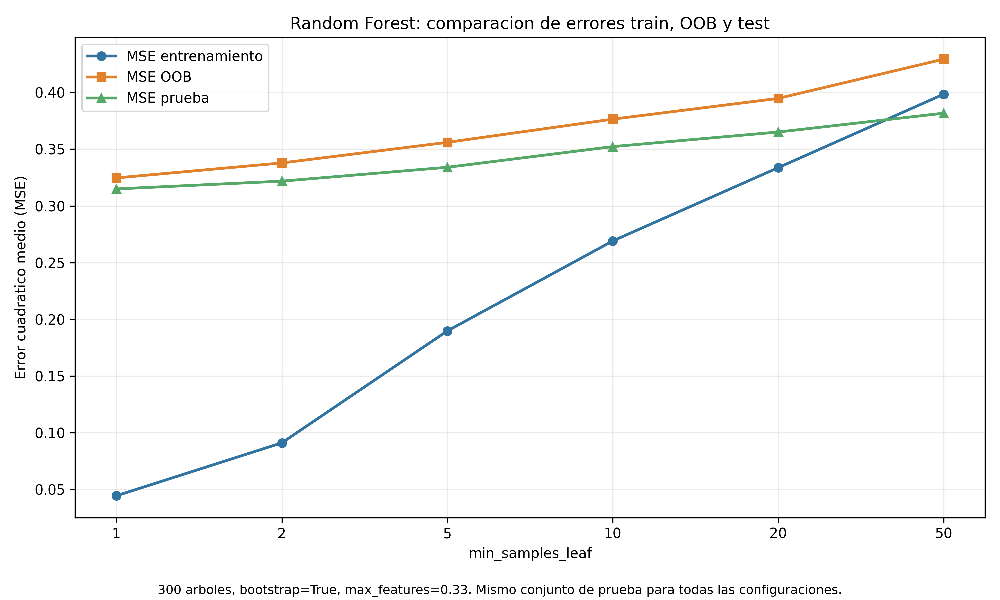

# 3.6. Comparación de errores de entrenamiento, OOB y prueba en Random Forest

## Objetivo
Examinar cómo cambia el ajuste y la evaluación fuera de muestra de un Random Forest al variar `min_samples_leaf`, utilizando los datos reales de Wine Quality Red.

## Metodología

Se utiliza la partición existente de 1279 observaciones de entrenamiento y 320 de prueba, con estandarización ajustada únicamente sobre entrenamiento. Para cada valor de `min_samples_leaf` en $\{1,2,5,10,20,50\}$ se entrena un bosque con 300 árboles, `max_features=0.33`, `random_state=0`, `bootstrap=True` y `oob_score=True`.

Se evalúan tres errores cuadrados medios:

- **MSE train:** predicción del bosque completo sobre los datos usados para entrenarlo.
- **MSE OOB:** para cada observación de entrenamiento, predicción agregada de los árboles en cuyos conjuntos bootstrap no apareció; permite una evaluación interna sin separar otro subconjunto de entrenamiento.
- **MSE test:** predicción del bosque completo sobre las 320 observaciones reservadas para prueba.

El método OOB requiere bootstrap y no es equivalente a evaluar el bosque completo sobre test: cada predicción OOB agrega solo un subconjunto de árboles.

En este experimento, el error OOB se utiliza como una estimación interna del desempeño predictivo fuera de muestra. Aunque cada observación se evalúa mediante árboles que no la incluyeron en su muestra bootstrap, las predicciones OOB no constituyen un conjunto de prueba completamente independiente del procedimiento de entrenamiento. Por ello, OOB resulta útil para comparar configuraciones sin recurrir continuamente al conjunto test, pero no sustituye necesariamente una evaluación final sobre datos reservados.

## Resultados

| `min_samples_leaf` | MSE train | MSE OOB | MSE test | Brecha OOB − train | Brecha test − train |
|---:|---:|---:|---:|---:|---:|
| 1 | 0.044377 | 0.324631 | 0.314927 | 0.280254 | 0.270550 |
| 2 | 0.091025 | 0.337836 | 0.321780 | 0.246811 | 0.230755 |
| 5 | 0.189696 | 0.355984 | 0.333998 | 0.166288 | 0.144302 |
| 10 | 0.269046 | 0.376444 | 0.352237 | 0.107399 | 0.083191 |
| 20 | 0.333670 | 0.394739 | 0.365094 | 0.061069 | 0.031423 |
| 50 | 0.398453 | 0.429337 | 0.381699 | 0.030884 | -0.016754 |

## Interpretación

1. Al aumentar el tamaño mínimo de hoja, el MSE train crece de 0.044377 a 0.398453: se reduce la flexibilidad del bosque.
2. En **este barrido concreto**, los errores OOB y test aumentan de manera monótona. El valor `min_samples_leaf=1` presenta el menor MSE test (0.314927) y el menor MSE OOB (0.324631). Una brecha grande entre train y test no significa por sí sola que el modelo tenga peor rendimiento de prueba que las alternativas.
3. El MSE OOB es mayor que el MSE test en las seis configuraciones. No tienen por qué coincidir: evalúan conjuntos y agregaciones de árboles diferentes.
4. Para `min_samples_leaf=50`, la brecha test − train es negativa (-0.016754); esto es posible en una partición particular y no invalida el experimento.

**Precaución metodológica:** los resultados son descriptivos del barrido. No se debe seleccionar una configuración usando reiteradamente el conjunto test como criterio de ajuste; para selección de hiperparámetros, sería preferible validación cruzada u OOB y conservar test como evaluación final.

## Relación con el inciso 3.4

En Monte Carlo, la estimación de ruido utilizó el RMSE OOB del bosque de referencia con `min_samples_leaf=10`. En esta comparación, el MSE OOB de esa configuración es 0.376444, cuyo valor de raíz cuadrada es aproximadamente 0.613551. Se trata de una estimación operativa de escala del error predictivo, no de una identificación exacta de la varianza irreducible del ruido.

La construcción de matrices suavizadoras de bosques en el inciso 3.1 utilizó `bootstrap=False`; en cambio, aquí se usa `bootstrap=True` para habilitar OOB. No debe trasladarse sin ajustes la fórmula de traza usada para el primer caso al segundo.

## Archivos reproducibles

- Código: `src/parte3/comparacion_oob.py`.
- Tabla: `resultados/tablas/parte3_comparacion_oob.csv`.
- Figura: `resultados/graficas/parte3_comparacion_oob.png`.

## Conclusión

El experimento muestra cómo la regularización por tamaño mínimo de hoja modifica el ajuste del bosque. OOB proporciona una evaluación interna útil de generalización y, en este caso, sigue la tendencia de test; sin embargo, ambas métricas no son idénticas ni garantizan el mismo valor numérico.
